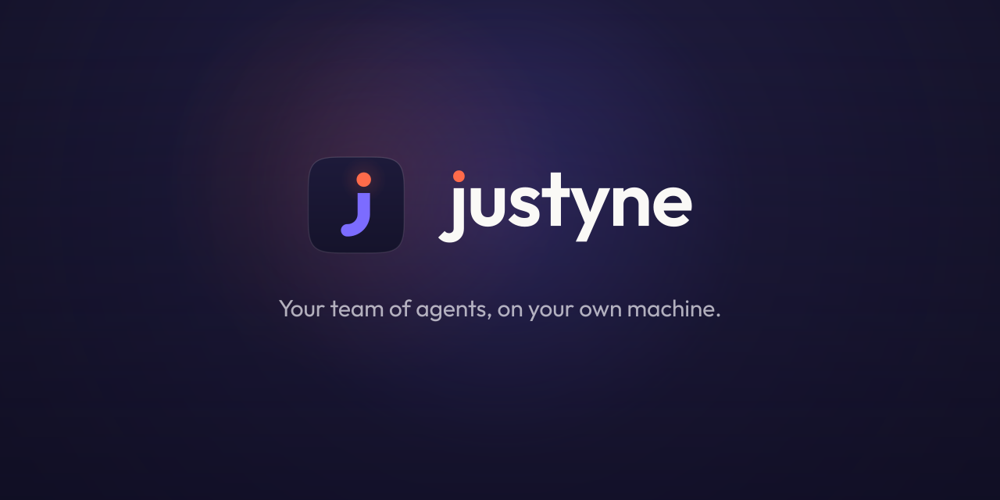

# Justyne

**A voice-first assistant for your Mac, with a team of AI agents behind it.**

[Download for Mac (Apple Silicon)](https://github.com/AdwaitPro/justyne/releases/latest) · [justyne.fun](https://justyne.fun)

## What it does

- **Talk to it.** Say "Hey Jarvis" or hold the shortcut, and speak. Justyne answers out loud in real time and can see your screen when you ask it to.
- **It does the work.** Open apps, play music and videos, find a file and send it on WhatsApp or Telegram, search the web, add groceries to your cart.
- **Agents in the background.** Hand a bigger job to one of your agents. It works on its own and tells you when it is done.
- **Your phone too.** Pair your Android phone with a QR code and talk to Justyne from anywhere on your Wi-Fi.
- **Local first.** Your chats, keys and memory stay on your Mac.

## Install

1. Download `Justyne-<version>-arm64.dmg` from the [latest release](https://github.com/AdwaitPro/justyne/releases/latest).
2. Open it and drag Justyne into Applications.
3. Launch Justyne and follow the short setup: add your Gemini API key (free at [aistudio.google.com](https://aistudio.google.com/apikey)) and allow Microphone, Screen Recording and Accessibility when asked.

Justyne updates itself when a new version is out.

## Requirements

- A Mac with Apple Silicon (M1 or newer)
- macOS 12 Monterey or later
- A Gemini API key for the voice
- Optional: the `claude`, `codex` or `grok` CLI for chat agents

Intel Macs are not supported yet.

## Privacy

Everything runs on your Mac. Anonymous usage analytics are off unless you turn them on in Settings. Voice audio goes to Google's Gemini API using your own key.

## Licence

Justyne is a derivative of [OpenMausBot](https://github.com/milind-soni/OpenMausBot) and is distributed under the Apache License 2.0. See [LICENSE](LICENSE) and [NOTICE](NOTICE). This repository hosts the signed and notarized app releases.
